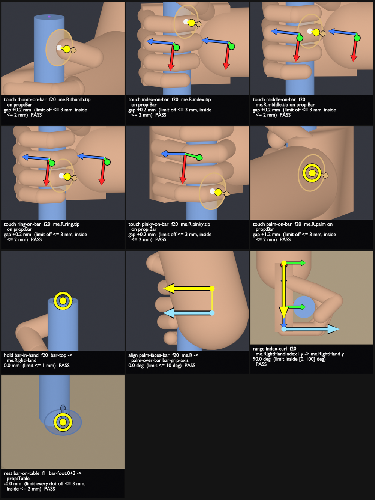
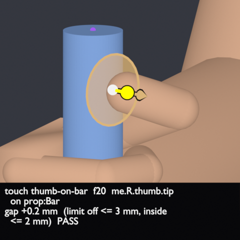
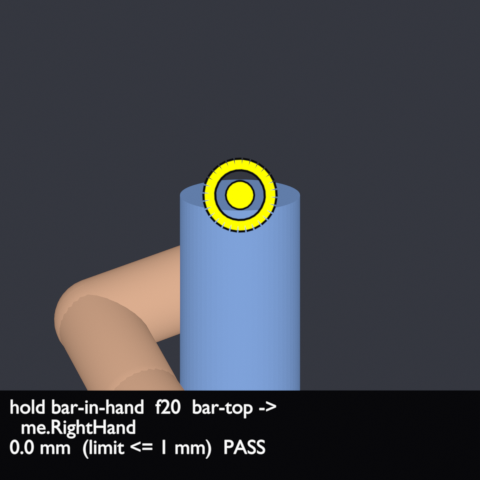
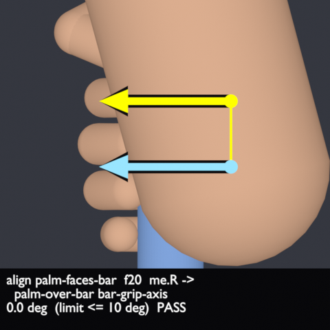
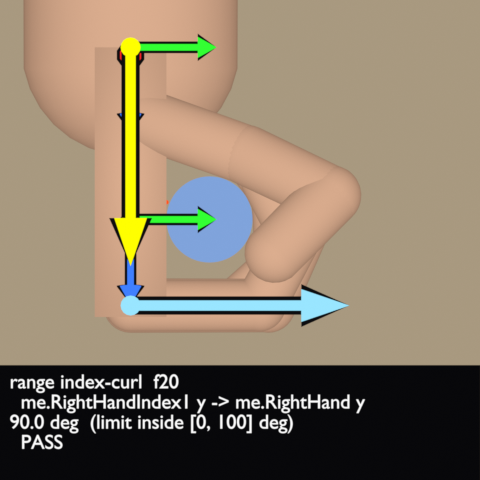
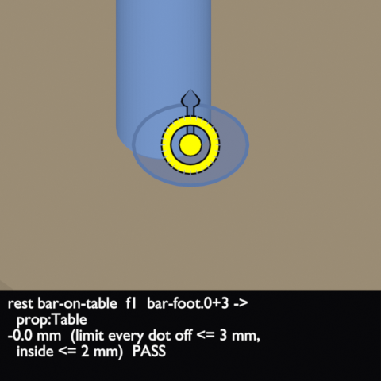

# ContactDots

**Do the things in your animation that should touch really touch?**

ContactDots measures it, in millimetres and degrees, on the real meshes. Point it at an FBX
or `.blend`, say what should be touching, sitting, staying put or lined up, and it tells you
which of those hold, frame by frame, and shows you a close-up picture of each one.

It is a Claude skill (a folder Claude loads on request) that runs Blender headless behind
the scenes. It **measures only**: it never changes your files and never fixes a pose.

> For AI agents and automation: read [AGENTS.md](AGENTS.md) instead.

## What you get

One picture sheet with a close-up per check, and a `dots.json` with every number.



Every tile is one check, with its number and PASS/FAIL in the caption. The coloured dots, rings and
arrows are what was measured; the small coloured axes on the hand (X red, Y green, Z light blue) only show orientation:

| | |
|---|---|
|  | **Touch.** The gap between a fingertip (or palm, foot, thigh...) and a surface, in mm; here +0.2 mm. The measured pair is joined by a line (yellow = within the limit, magenta = outside it) and a disc marks the spot on the touched surface. |
|  | **Hold.** Something stays put in a frame of reference: here the bar has moved 0.0 mm in the hand's frame since frame 20. Also for a planted foot not skating. |
|  | **Align.** Two directions line up, in degrees: here the palm normal and the palm-to-bar direction (the two parallel arrows) differ by 0.0 deg. Also a bolt lined up with its slot. |
|  | **Range.** A hinge or joint stays inside its limits: here the index knuckle curl, measured between two bone directions. Also an elbow that never bends backwards. |
|  | **Rest.** A part lies flat on a surface: here the bar's foot on the table. One corner up is a fail. |

Also available: **seat** (a magazine seated in its well) and **distance** (two hands a fixed
span apart). Every run also reports every **penetration**, whether you asked or not.

The example above is `examples/grab/`: a plain mannequin reaches for a bar, grips it and lifts it.
Its expected result is `PASS`, 10 of 10 checks, 0 penetrations.

## Quick start

You need Blender (any recent version) and Python 3. Nothing else.

1. **Install the skill.** Either run `python tools/install.py` (copies it into your Claude
   skills folder and builds `dist/contact-dots.zip`), or unzip `dist/contact-dots.zip` into the
   skills folder yourself.
2. **Check the machine** (known answers, about half a minute):
   ```
   python skill/contact-dots/scripts/dots.py selftest
   ```
3. **Ask Claude**, in plain words:
   > Check that her right palm is really on his left thigh at frame 40, and that nothing
   > penetrates.

   Claude writes the config, runs the measurement, looks at the sheet and reports.

   Or do it by hand with a config file:
   ```
   python skill/contact-dots/scripts/dots.py measure examples/grab/config.json
   ```

Try the bundled example first, it runs in under a minute:
```
cd examples/grab
python ../../skill/contact-dots/scripts/dots.py measure config.json
```
```
dots: PASS grab showcase limits finger (off <= 3 mm, inside <= 2 mm): checks 10/10 pass, 0 penetration(s) deeper than 2 mm
  touch thumb-on-bar me.R.thumb.tip -> prop:Bar: worst +0.2 mm f20 ...  PASS
  touch palm-on-bar me.R.palm -> prop:Bar: worst +1.2 mm f20 ...        PASS
  ...
  sheet .../out/dots-sheet.png (10 close-ups; LOOK at it)
```
`out/dots-sheet.png` is the sheet shown above.

## A config, in one minute

"Her right palm on his left thigh at frame 40":

```json
{"out": "dots_out",
 "characters": [{"role": "her", "file": "her.fbx"}, {"role": "him", "file": "him.fbx"}],
 "frames": [40],
 "checks": [{"id": "palm-on-thigh", "kind": "touch",
             "a": "her.R.palm", "b": "him.LeftUpLeg", "frames": [40]}]}
```

- `role` is a short name for each character; its dots are `<role>.<dot>`.
- Dots sit on the hands, limbs, feet and pelvis: `R.index.tip`, `R.palm`, `L.thigh.2`, `R.heel`,
  `pelvis.front`... Use a group (`her.R.hand`) to mean "any dot of the hand".
- A surface is a character (`him`), one of its bones (`him.LeftUpLeg`), a prop
  (`prop:Cup`), the `floor`, or `nearest`.
- Mixamo and Unity humanoid rigs map on their own; for any other rig, write a `boneMap`
  (`python skill/contact-dots/scripts/dots.py bones her.fbx` proposes one).

Full reference: [config](skill/contact-dots/references/config.md),
[one example per check kind](skill/contact-dots/references/checks.md),
[the result file](skill/contact-dots/references/results.md).

## Reading the answer

- **Gaps are skin to surface, in mm.** Positive = apart, negative = inside. By default a touch
  may be at most 3 mm off and 2 mm inside (`finger`); `limb` allows 10 mm.
- A touch that fails with a positive worst gap is floating. A large negative one is sinking in.
- **Always look at the sheet.** A pass on the wrong dot is a wrong answer: check each tile
  shows the right hand, the right thigh, the right frame.
- With two characters, check the printed root positions first. Two FBX files do not always
  share one world frame, and then no pair number means anything.

## What it does not do

It does not fix poses, simulate physics or balance, check mouth or cloth contact, or test
mesh-against-mesh overlap. It tells you what is wrong and where; you fix it.

## Repository

| Path | What |
|---|---|
| `skill/contact-dots/` | The product: `SKILL.md`, `scripts/`, `references/`. |
| `examples/grab/` | The showcase scene (`grab.fbx`, `grab.blend`, `config.json`, and `build_grab.py` that rebuilds it with no outside assets). |
| `docs/images/` | The pictures on this page, made by the example. |
| `tests/` | The tests, with real mesh samples kept outside the skill folder. |
| `tools/install.py` | Installs the skill and builds `dist/contact-dots.zip`. |

Tests: `python -m pytest -q` (needs `pytest`, and `numpy` for the real-sample tests).
Without a Blender install, the Blender-dependent tests are skipped.
